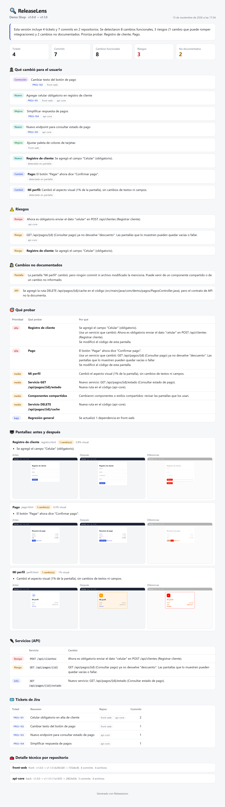

# 🔍 ReleaseLens

**¿Qué cambió en este release? Respondido en lenguaje de usuario, sin preguntarle a cada desarrollador.**

Jenkins despliega nuevas imágenes del front y del back… y QA se queda adivinando qué cambió. ReleaseLens compara la versión anterior con la nueva en **varios repositorios a la vez**, revisa los **servicios (API)** y las **pantallas**, y genera un reporte que cualquier tester o persona de negocio entiende:

- 👤 **Qué cambió para el usuario**, agrupado por ticket de Jira
- ⚠️ **Riesgos**: servicios que pueden romper integraciones o pantallas
- 🕵️ **Cambios no documentados**: lo que cambió en la app pero ningún commit menciona
- 🎯 **Qué probar**, con prioridad alta, media o baja
- 🖥️ **Capturas de antes, después y diferencias** de cada pantalla



## Cómo funciona

ReleaseLens cruza **tres fuentes de verdad**:

| Fuente | Qué obtiene | Cómo |
|---|---|---|
| **Código (git)** | Commits, tickets de Jira, archivos y pantallas tocadas, rutas de API nuevas o eliminadas, dependencias | `git log` y `git diff` entre las dos versiones de cada repo. Funciona con cualquier lenguaje |
| **Contrato de API** (opcional) | Servicios nuevos o eliminados, datos obligatorios, campos que ya no se devuelven | Compara el OpenAPI/Swagger de ambas versiones (desde el repo o por URL) |
| **Aplicación desplegada** (opcional) | Textos, campos, botones y diferencias visuales | Playwright abre cada pantalla en ambas versiones y las compara |

Al cruzar **lo que dice el código** con **lo que cambió en la aplicación**, detecta los cambios que nadie documentó.

> ¿El backend no tiene Swagger? No pasa nada: ReleaseLens detecta las rutas directamente en el código para **Spring, Express, NestJS, .NET, FastAPI y Flask**.

## Pruébalo en 1 minuto

Necesitas Node.js 20+ y git.

```bash
git clone https://github.com/diazb98/release-lens.git
cd release-lens
npm install
npx playwright install chromium
npm run demo
npm run report
```

La demo crea una tienda ficticia ("Demo Shop") con dos repositorios (`front-web` y `api-core`) y dos versiones, `v1.0.0` y `v1.1.0`, con cambios típicos de un release real: un campo obligatorio nuevo, un botón renombrado, un campo eliminado de un servicio, un endpoint nuevo… y dos cambios que **nadie documentó**.

## Úsalo con tu proyecto

1. Copia [`releaselens.example.json`](releaselens.example.json) como `releaselens.json` y ajústalo.
2. Ejecuta:

```bash
node bin/release-lens.mjs --config releaselens.json --from v2.3.0 --to v2.4.0
```

### Configuración

```jsonc
{
  "title": "Mi Sistema - QA",
  "repos": [
    // Repos locales o URLs. "from"/"to" aceptan tag, commit o rama.
    { "name": "front-web", "kind": "front", "source": "https://git.empresa.com/front-web.git", "to": "${FRONT_COMMIT}" },
    { "name": "api-pagos", "kind": "back", "source": "../api-pagos", "from": "v1.4.0", "to": "v1.5.0" }
  ],
  "jira": { "baseUrl": "https://empresa.atlassian.net/browse/", "projects": ["PAG"] },
  "api": [
    { "name": "api-pagos", "repo": "api-pagos", "file": "openapi.yaml" },            // OpenAPI versionado en git
    { "name": "otra-api", "old": { "url": "https://prod/v3/api-docs" }, "new": { "url": "https://qa/v3/api-docs" } }
  ],
  "ui": {
    "old": { "baseUrl": "https://app.prod.empresa.com/" },
    "new": { "baseUrl": "https://app.qa.empresa.com/" },
    "storageState": "./auth/sesion.json",   // sesión de Playwright si la app tiene login
    "pages": [
      { "name": "Pago", "path": "pago", "apis": ["/api/pagos"] },          // "apis" conecta riesgos de servicios con pantallas
      { "name": "Mi perfil", "path": "perfil", "match": ["perfil", "profile"] }
    ]
  },
  "ai": { "provider": "prompt" }
}
```

- `${VARIABLE}` se reemplaza por variables de entorno, ideal para Jenkins.
- `api` y `ui` son opcionales: puedes empezar solo con git.

### Opciones

| Opción | Descripción |
|---|---|
| `--config <archivo>` | Archivo de configuración (por defecto `releaselens.json`) |
| `--from` / `--to` | Versiones para todos los repos |
| `--ref repo=a..b` | Versiones de un repo específico (se puede repetir) |
| `--state <archivo>` + `--save-state` | Recuerda lo último desplegado y lo usa como "from" la próxima vez |
| `--ai <proveedor>` | `none`, `prompt`, `anthropic`, `openai-compatible` |
| `--fail-on-breaking` | Falla el pipeline si un servicio tiene cambios que rompen compatibilidad |
| `--out <carpeta>` | Carpeta del reporte (por defecto `release-report`) |

### Resultados

- `index.html`: el reporte visual
- `resumen.md`: versión corta para pegar en Teams, Slack, Jira o un correo
- `report.json`: todos los datos, para integraciones
- `assets/`: capturas de antes, después y diferencias

## Integración con Jenkins

Agrega una etapa después del despliegue (ver [`Jenkinsfile.example`](Jenkinsfile.example)):

```groovy
sh 'node bin/release-lens.mjs --config releaselens.json --state "$JENKINS_HOME/release-lens/state-qa.json" --save-state'
```

Con `--state`, cada despliegue se compara automáticamente contra el anterior. Ya no tienes que saber qué versión había antes.

## IA opcional (y segura)

El reporte funciona **sin IA**: la traducción a lenguaje de usuario se hace con reglas. Si quieres un resumen redactado:

| Proveedor | Para quién |
|---|---|
| `prompt` | Empresas que solo permiten **Copilot** u otra IA interna: genera `prompt-para-ia.md` para pegarlo en el chat aprobado |
| `anthropic` | Claude (variable `ANTHROPIC_API_KEY`) |
| `openai-compatible` | Azure OpenAI, GitHub Models, Ollama, LM Studio… (`baseUrl`, `model`, `apiKeyEnv`) |

🔒 **ReleaseLens nunca envía código fuente a la IA**: solo envía el resumen de cambios (títulos de commits, tickets y cambios detectados). Aun así, revisa la política de tu empresa antes de activarla.

## Limitaciones conocidas

- La detección de rutas en el código es heurística: no combina prefijos de clase (por ejemplo, `@RequestMapping` a nivel de controlador en Spring).
- "No documentado" se decide por coincidencia de palabras entre la pantalla o servicio y los commits o archivos. Usa `match` en la configuración para afinarlo.
- Las pantallas con datos dinámicos (fechas, montos) pueden generar diferencias visuales. Ajusta `visualThreshold`.

## Estructura

```
src/git.ts          ← commits, Jira, archivos, rutas y dependencias por repo
src/classify.ts     ← clasifica archivos y detecta endpoints en 6 frameworks
src/api-diff.ts     ← compara contratos OpenAPI/Swagger
src/ui-diff.ts      ← compara pantallas con Playwright (contenido + píxeles)
src/analyze.ts      ← cruza todo: cambios, riesgos, no documentados, qué probar
src/ai.ts           ← resumen opcional con IA
src/report/         ← reporte HTML y Markdown
demo/setup-demo.mjs ← crea la app de demostración con dos versiones
```

## Licencia

MIT
